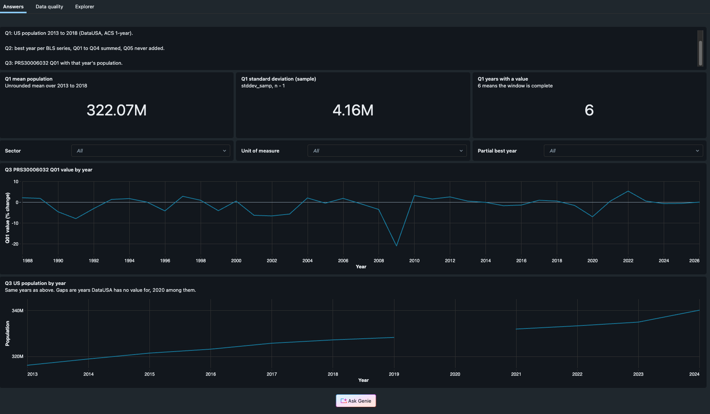

# PROCESS

How this pipeline is put together, what it trades away, what the data taught me, and what a production version would add. README.md has the run instructions and the list of corner cases.

## 1. Architecture

### Layers

| Layer | Where | What it holds | Why |
|---|---|---|---|
| Raw | Volume `quest_raw.landing` | Every downloaded blob at `<source>/<file_name>/sha256=<hash>/<file_name>` | Content-addressed paths make a second write of the same bytes a no-op, and every version stays available for replay. |
| Ops | `quest_ops` | `file_versions` (one row per blob), `file_state` (current pointer per file), `ingest_runs` and `ingest_run_files` (per-run audit), `table_versions`, `dq_checks`, `pipeline_event_log` | The manifest is the source of truth for what is current. Silver reads it; nothing infers "current" from file times. |
| Bronze | `quest_bronze` | Auto Loader streaming tables, one per file role, all STRING, values verbatim with padding, plus `_source_path`, `_file_name`, `_sha256`, `_ingested_at`, `_rescued_data` | Bronze is a faithful copy of every version that ever landed. Nothing is cleaned here, so any silver rule can be rerun against the original bytes. |
| Silver | `quest_silver` | Materialized views over bronze joined to `file_state`: typed, trimmed, canonical labels, natural keys, informational PK/FK. Each table has a `<table>_quarantine` twin with the raw strings, `dq_reasons` and lineage | Joining to the pointer table means a new version, a revert or a delete is a pointer change, and the view follows it. |
| Gold | `quest_gold` | `population_stats_2013_2018` (Q1), `series_best_year` (Q2), `prs30006032_q01_with_population` (Q3), and `productivity_observations`, a denormalized fact for the dashboard and Genie | One table per question, with the columns a reader needs to judge the answer (partial years, ties, units). |

Silver is the place where rows are judged. A private `_<table>_flagged` view computes a `dq_reasons` array from `rules.yml`, null-safe, so a NULL predicate counts as a failure and never silently passes. Rows with no reasons go to silver; the rest go to the quarantine twin. Pipeline expectations exist too, mostly as warnings for metrics in the event log; the one that stops an update is `LOOKUP_EMPTY` (`expect_all_or_fail`), because a lookup with no valid rows would blank every label. The routing decision lives in my code, where it is unit-tested.

The file contracts (`src/quest/contracts/yaml/*.yml`) hold, per file role, the ordered columns with their source header aliases and types, the key, and the label map from source text to canonical text (for example "Seasonal Adjusted" becomes "Seasonally Adjusted", with the original kept in `seasonal_text_source`). The same loader feeds the ingest header check, the bronze schemas, the silver casts, the DQ rules, the validate checks and the table comments.

Four patterns here come from my last job at Truckmentum: rejected rows routed with reason codes, header and schema normalisation into a canonical schema, lookup enrichment, and a per-run audit with alerting (there it went to a webhook; here it is email and a SQL alert).

### SQL vs PySpark

Gold is SQL first: `src/pipeline/transformations/gold.sql` defines the four materialized views, and that is what the pipeline publishes. The PySpark versions live in `src/quest/gold/pyspark_gold.py` as plain functions over DataFrames. Both are tested against each other:
- locally, `tests/spark/test_gold.py` extracts each SELECT from `gold.sql`, runs it with `spark.sql` over fixture tables, runs the PySpark twin over the same tables, and asserts the same columns, types and rows;
- in the workspace, the validate task does the same comparison on the full data and fails the job on any mismatch.

I picked SQL as primary because the questions are set logic (aggregate, rank, join) and SQL is the shorter, easier-to-review form. Bronze and silver are Python, because they are generated from the contracts in a loop and the transform functions are unit-tested without a workspace.

### Safe reruns

- **Ingest downloads only what changed.** For each BLS file the planner compares a fingerprint (listing size plus the raw listing time string) with `file_state`. Same fingerprint: skip. Size differs, or the file is new or its landing is missing: a plain GET. Same size but a different time string (the daylight saving shift): a GET with `If-Modified-Since`, and a 304 only updates the fingerprint. A 200 is hashed in memory; a hash equal to the current one is `SAME_HASH`, a known older hash is `REVERTED_TO_KNOWN_VERSION`, a new hash lands a new blob.
- **Pointers move all or nothing.** Blobs and `file_versions` rows are written as they land, but `file_state` changes in one MERGE at the end, and only if every file succeeded. A failed or crashed run leaves silver exactly where it was.
- **The pipeline runs only when needed.** The ingest task sets `run_pipeline` and a condition task skips the pipeline unless a served pointer is not yet in silver lineage, silver serves a version that no longer has a pointer (a deleted file), the last update did not succeed, the code version changed, or `force_pipeline` is set.
- **Validate proves it.** `NO_CHANGE_ON_RERUN` compares this run's `table_versions` (Delta version where readable, row count and a `sum(xxhash64(*))` checksum) with the previous run, and fails if a table changed with no upstream or code change: ingest flipped no pointer and the gate saw no new code version. After a deploy that changes what the pipeline computes, the first run reports "change expected: code version changed" and lists the tables that moved; the second run of the same code shows the pipeline task excluded and "0 tables changed".
- **Concurrency.** `max_concurrent_runs: 1`, and the content-addressed paths plus MERGEs make an accidental double run harmless anyway.

## 2. Trade-offs

**Schema drift.** I chose to fail loudly. Ingest checks each BLS header against its contract after trimming, lowercasing and alias mapping. On a mismatch the file still lands (with `header_ok=false` and the diff), but the run fails and no pointer moves, so silver keeps serving the last good version. DataUSA is checked for shape (`data` present, `page.total` equal to the record count, expected columns) before anything lands. Bronze uses explicit schemas, so a new column cannot widen a table by accident, and a line with the wrong field count keeps its raw text in `_rescued_data`. The cost is that a harmless upstream rename stops the feed until someone adds an alias. For a source that changes a few times a decade, I prefer that to silently mis-mapped columns.

**Volume.** AllData is 77,126 rows, so every silver and gold view is fully recomputed on each pipeline update, in seconds. Bronze grows by about 77k rows per BLS release (BLS updates `pr` about eight times a year). I did not add clustering or incremental silver; at tens of millions of rows I would cluster the observations on `series_id`, and move silver from a full recompute to incremental processing keyed on the pointer change.

**Cost.** Everything runs on Free Edition serverless and the 2X-Small SQL warehouse. The job is weekly (BLS updates `pr` about eight times a year), the gate skips the pipeline on a no-op run, and the planner skips unchanged files, so a quiet week costs one listing request, one small DataUSA GET, nothing new landed and a short validate task. The dashboard, the alert (paused in dev, so it costs a query only when evaluated by hand) and Genie share the same warehouse.

**Access control.** Free Edition is a single-user workspace, so everything runs as me and nothing is granted. The dashboard sets `embed_credentials: false` explicitly, so a viewer queries with their own rights. In production the gold schema would be the only thing analysts can read (see section 5); quarantine and ops tables would be for the data team.

**Monitoring.**
- structlog JSON in every task's output, each event carrying the run id.
- `ingest_runs` and `ingest_run_files`: what each run did with each file, its HTTP status, bytes and timing.
- `dq_checks`: one row per check per run (39 today), severity and observed value.
- The pipeline event log is published to `quest_ops.pipeline_event_log`, so expectation metrics are queryable in SQL.
- Alerts: job failure email, pipeline failure email, and the SQL alert `quest_dq_alert`, which fires on any warn, fail or error check in the latest run, or when AllData is more than 100 days past its Last-Modified (or has no state row). In dev the alert is deployed paused and evaluated by hand from its page; a prod target would unpause its daily schedule.
- The AI/BI dashboard's Data quality page shows runs, file actions, quarantine by reason, expectation pass rates and freshness.

What is missing: nothing watches the job itself. If it stops running, `dq_checks` keeps showing the last good run, and the only signal is the freshness rule, which fires about 100 days after AllData's Last-Modified, and only once the alert is evaluated (by hand in dev, on its schedule in prod). A check on the age of the latest `ingest_runs` row would catch it within a week. There is also no webhook destination.

## 3. Data findings that shaped the design

Both sources were profiled before any design work, and most of the design follows from what that showed:
- **No User-Agent means 403.** BLS requires a contact User-Agent. It comes from a Databricks secret and is sent on every request, with requests sequential and at least a second apart.
- **Listing times are not a change signal.** They are server local, minute precision, no zone, and they all moved by an hour when US daylight time ended during the build. Hence the fingerprint plus conditional GET plus sha256 chain.
- **ETags do not identify content.** IIS derives them from the file time: the nine files written on 2026-09-03 shared one ETag, and `If-None-Match` was ignored. `If-Modified-Since` does work (304).
- **Padded, irregular headers.** Files are tab-delimited with CRLF; `series_id` and `value` are padded, header included; `pr.seasonal` has `Seasonal_code` with a capital S and the label "Seasonal Adjusted" (sic). Auto Loader's rescued-data column matches CSV columns by header name, which nulled every padded column in my first pipeline run, so bronze maps columns by position and uses the corrupt-record column for bad lines.
- **Q05 is the annual value.** It is a fifth period next to Q01 to Q04. BLS names it "Annual Average", but for percent-change series it is not the mean of the quarters, so it can neither be derived from them nor added to them. It stays in silver with `is_annual_average` and is excluded from the Q2 sums.
- **45 annual-only series** have nothing but Q05 rows, so they have no quarterly best year.
- **Ties and partial years are real.** PRS84006021 (1964 and 2010) and PRS84006102 (1974 and 1980) tie; PRS32006212's best year, 1987, has three quarters.
- **`pr.data.0.Current` is a strict subset of AllData** with no value differences. Unioning them would duplicate 38,469 rows, so Current lands, is checked, and never feeds silver.
- **DataUSA skips 2020.** The ACS 1-year estimate for 2020 was not published, so Q3 has to be a LEFT JOIN and population nullable.
- **Population arrives as a float** (`316128839.0`), and the JSON reader turned it into `3.16128839E8` in a STRING column, which my first rules quarantined. The rules now accept exponent form and check integrality before the BIGINT cast.
- **A recompute changed Q1.** `stddev_samp` sums doubles in row order, and the same rows in another order moved the last digits, which failed the no-op check on the workspace. Q1 now uses exact DECIMAL sums and a single square root.

## 4. Decision log (condensed)

| Topic | Decision | Why |
|---|---|---|
| Change detection | Listing fingerprint, then `If-Modified-Since`, then sha256; never listing time or ETag alone | Both are unreliable on this server (section 3) |
| Partial failure | All-or-nothing pointer MERGE | Silver never serves a half-updated release |
| Deletes | First absence `missing` (still served), second `deleted`; abort on an empty or half-empty listing | One flaky listing must not empty silver |
| Storage of versions | Content-addressed Volume paths, every version kept | Reverts and replays are free; reruns cannot duplicate |
| Bronze | Auto Loader, explicit all-STRING schemas, verbatim values | Silver rules can always be rerun on the original bytes |
| Silver | Materialized views joined to `file_state`, quarantine twin per table | Pointer changes drive what is served; no row disappears |
| Lookups | Separate silver lookup tables plus labels folded into `bls_pr_series` with a `series_label` | Readable answers without joins in every query |
| Units | `unit_of_measure`, `change_basis`, `base_year` on the series from an explicit duration map | Percent changes and indexes must never be mixed |
| Values | `DECIMAL(12,3)` | BLS publishes 1 and 3 decimals; no float noise in sums |
| Keys | Natural keys, informational PK/FK, NOT NULL on keys | Explainable, and Genie and the dashboard read the constraints |
| Q2 | Sum Q01 to Q04 only, earliest year wins ties, partial years flagged, annual-only series kept | Literal answer to the question, with what a reader needs to judge it |
| Q3 | LEFT JOIN, 39 rows, population nullable | 2020 is missing upstream |
| Gold language | SQL primary, PySpark twins, parity tested locally and in the job | Short reviewable SQL, proven equal |
| Pipeline trigger | Condition task on `run_pipeline` | No pipeline cost on a no-op week |
| Validate | Separate wheel task writing `dq_checks` and `table_versions` | Checks that need the whole picture (parity, reconciliation, no-op proof) |
| Ingest task | A notebook task calling `quest.ingest.main` | Task values can only be set from a notebook |
| Deployment | Declarative Automation Bundle (formerly Databricks Asset Bundles), one `dev` target, wheel built with uv | Everything as code, one command |
| CI | Lint, mypy, tests with Java 17, `bundle validate`; deploy on main | The same make targets as local |
| Alerting | Email on job and pipeline failure, SQL alert on `dq_checks` and freshness (paused in dev, evaluated by hand), no webhook | Enough for one maintainer |
| Dashboard Q3 | Two stacked single-axis line charts (value and population by year), not one dual-axis chart | Dual axes with unrelated units imply a correlation that is only the choice of scales |
| Genie | The four gold tables only; trusted queries read the gold views | The answers are computed once, in gold.sql; Genie cannot fork them |
| Testing | Local pyspark on committed real-file slices; DataFrame tests also on serverless via databricks-connect | Fast feedback, real bytes, no workspace needed for most tests |

## 5. What production would add

- **A prod target.** A second bundle target in `mode: production` with its own catalog (for example `quest_prod`), the schedule unpaused, and `run_as` a service principal so jobs do not depend on a person's account.
- **Service principal and OIDC in CI.** Replace the personal access token in GitHub secrets with GitHub OIDC federated to a Databricks service principal, so no long-lived token exists. Deploy to prod from tags or a protected branch after `dev` passes.
- **Grants.** An analyst group with `USE CATALOG`, `USE SCHEMA` and `SELECT` on `quest_gold` only, `CAN USE` on the warehouse, and access to the dashboard and the Genie Agent. The data team gets `quest_silver` (including quarantine) and `quest_ops`. Nobody but the service principal writes.
- **A human correction loop for quarantined rows** (designed, not built). A Databricks App shows an editable grid over the quarantine tables. A data steward fixes a value, and the fix is applied by landing a corrected file version tagged as steward-corrected, so it flows through the same contracts, rules and audit as a BLS file. A correction stays in force while the raw bad value is unchanged, and expires when BLS publishes something different for that row.
  - Good: every fix is versioned and audited like source data; nothing is patched in place in silver; the same quality rules judge the fix; replaying history gives the same result.
  - Pitfalls: a correction can hide a real upstream problem if nobody tells BLS; matching "the same bad value" across releases needs a stable row key, which lookups have and some files may not; stewards need clear ownership and review, or fixes pile up; and a corrected file is no longer a byte-exact copy of the source, so the raw landing must keep both.
- **Revision history** (designed, not built). Silver is the current release (SCD type 1), but bronze keeps every version, so history can be rebuilt. The design is one more view, `bls_pr_observation_history`: one row per key per interval of releases where its value and footnotes stayed the same, ordered by AllData pointer flips from `ingest_run_files` (so a revert A to B to A is an interval too), with tombstones for rows that disappear. Its current rows must equal silver exactly, which is a strong check on both.
- **The alternative I considered: AUTO CDC FROM SNAPSHOT.** Lakeflow can build SCD type 2 from successive snapshots (`create_auto_cdc_from_snapshot_flow`). It would replace my history view with a managed flow. I kept the manifest and views because they are plain SQL I can test locally, they carry the same expectations as the rest of silver, and the snapshot flow would still need a function that walks my manifest to hand it versions in order.
- **Smaller items.** An alert when the job has not run on schedule; a webhook or chat destination for the alert; clustering and incremental silver at higher volume; the rules I designed but did not build (PRECISION_MISMATCH, POP_YOY_JUMP, lookup attribute rules).

## 6. Retrospective

**What surprised me.** Everything passed locally, and the workspace runs and reviews still found six problems no local test could. Auto Loader matched CSV columns by header name, so the padded BLS headers turned every value into null until I read by position. The JSON reader rendered 316128839.0 as 3.16128839E8, which my integer rule rejected. Materialized views refuse `DESCRIBE HISTORY`. A dry-run update reported COMPLETED like a real one. Serverless retried a task I had set to zero retries. And Spark's built-in `stddev` gave a different 12th digit on a rerun with identical input. Next time I would run a one-hour platform probe before writing transforms, not after.

**Proving idempotency instead of claiming it.** I made "a rerun changes no table" a validate check, NO_CHANGE_ON_RERUN, rather than a sentence in this document. It paid for itself. It caught the stddev drift on a recompute after a deploy, and it exposed two gaps in its own design: the first run has no baseline, and a code deploy legitimately changes tables. I would build that check first on the next project.

**Scope versus time.** The manifest, the quarantine twins, the contracts, the bundle, CI and the BI layer took about two days of focused work. In a team I would ship ingest, silver and gold first, prove the answers, and add the data quality and BI layers in later iterations.

**First time on Databricks.** A lot mapped cleanly from what I know: the job is the Airflow DAG, a Volume path is an S3 prefix, the manifest is the watermark table I would keep in Postgres, and a secret scope is Secrets Manager. Other things were new: materialized views that recompute themselves, Auto Loader checkpoints that never re-read a file, and task values that only notebooks can set.

## 7. AI use

I built this with an AI coding assistant. In practice:
- **My part.** I made the design decisions in structured rounds, where the options and their trade-offs were laid out as multiple-choice questions and I picked one; about 100 decisions are recorded that way. Along the way the assistant also made smaller calls, for example how to work around a platform behaviour it ran into; I reviewed and ratified those.
- **The assistant's part, under my direction.** It drafted the research notes, the design options, the code and the tests, README.md, this PROCESS.md and CLAUDE.md, and the dashboard, alert and Genie definitions. It ran the workspace work through my Databricks CLI login: deploys, job runs, verification SQL, the Genie checks and cleanup. It found and fixed the defects that only showed up on the workspace (several are in section 3).
- **Review.** Separate AI review passes checked each phase of the build, and I reviewed the result.

## Screenshots

The **Answers** page of the AI/BI dashboard, built on the gold tables: the Q1 mean, standard deviation and year count, then the two Q3 charts with the 2020 gap visible.

