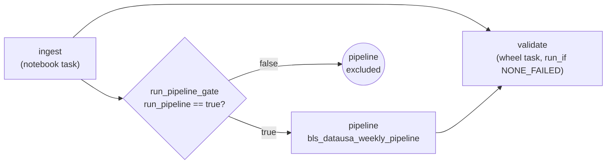
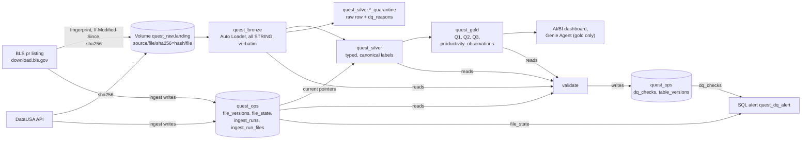

# rearc-data-quest

A small production-style feed on Databricks Free Edition. It mirrors the BLS Productivity and Costs time series (`pr`) and the DataUSA US population API into a Unity Catalog Volume, builds bronze, silver and gold tables with a Lakeflow Spark Declarative Pipeline (formerly DLT), and answers three analytical questions in both Spark SQL and PySpark. One weekly job runs it end to end, and a rerun with no upstream or code change lands nothing new and changes no table (it still makes one small GET to DataUSA).

How it was built and why: [PROCESS.md](PROCESS.md).

## Architecture

The job `bls_datausa_weekly_ingest`:



The data flow:



- **ingest** lists BLS, fetches only what changed, lands each new blob at a content-addressed path, and records it in `quest_ops`. It moves every `file_state` pointer in one MERGE, and only if every file succeeded. It then sets the task value `run_pipeline`.
- **run_pipeline_gate** is a condition task. The pipeline runs only if a served pointer is not yet in silver, silver serves a version that no longer has a pointer (a deleted file), the last pipeline update did not succeed, the deployed `code_version` changed, or `force_pipeline` is true.
- **pipeline**: bronze streaming tables read the Volume; silver materialized views serve only the versions `file_state` points at and split bad rows into quarantine twins; gold is SQL (`gold.sql`), with PySpark twins in `quest.gold`.
- **validate** checks SQL vs PySpark parity, reconciliation to bronze, row counts, duplicate keys, quarantine rates, freshness and the no-op proof (`NO_CHANGE_ON_RERUN`), and writes the results to `quest_ops.dq_checks`.

## Run it

Prerequisites: a Databricks workspace (Free Edition works), Databricks CLI 1.23+, uv, Python 3.12, JDK 17. The bundle looks up the SQL warehouse named "Serverless Starter Warehouse" (the Free Edition default); for another one, pass `--var warehouse_id=<id>` to `databricks bundle deploy`. The catalog is the bundle variable `catalog` (default `workspace`); `src/sql/bootstrap.sql` names it literally, and the Genie space JSON takes it from the variable's default when `make bi` regenerates it, so for another catalog edit bootstrap.sql, change the default and run `make bi`. Once per workspace: run `src/sql/bootstrap.sql` on the SQL warehouse (schemas and Volume), and store the contact email BLS asks automated clients to send: `databricks secrets create-scope quest`, then `databricks secrets put-secret quest bls_contact_email`.

```
make setup            # venv with all dependency groups, plus git hooks
make test             # unit tests and local PySpark tests
databricks auth login --host https://<your-workspace>.cloud.databricks.com
make deploy           # databricks bundle deploy -t dev: wheel, job, pipeline, dashboard, alert, Genie
make run              # databricks bundle run -t dev bls_datausa_weekly_ingest
```

Run `make run` a second time: the pipeline task shows as excluded and validate passes `NO_CHANGE_ON_RERUN`. The DQ alert is deployed paused; evaluate it by hand from its page in the workspace, or set its `pause_status` to `UNPAUSED` in `resources/quest_dq_alert.alert.yml` and redeploy. CI (`.github/workflows/ci.yml`) runs lint, mypy, the tests and `bundle validate` on pushes to main and on pull requests, and deploys `dev` on pushes to main; it needs the repo secrets `DATABRICKS_HOST` and `DATABRICKS_TOKEN`.

## Corner cases covered

Ingestion:
- **DST listing shift.** BLS listing times are server local with no zone, and they all moved by an hour when US daylight time ended. A changed listing time only triggers a conditional GET; a 304 updates the stored fingerprint and nothing is downloaded.
- **Shared ETag.** IIS derives the ETag from the file time: the nine files written on 2026-09-03 shared one ETag. ETags are never used; change is decided by the sha256 of the bytes.
- **If-Modified-Since.** Every changed-looking file is fetched with `If-Modified-Since`, and a 304 costs one small request.
- **Revert A to B to A.** Versions are content-addressed and kept. When a file goes back to earlier bytes, its listed size changes, so it is fetched without `If-Modified-Since` (an older file would otherwise earn a 304) and hashed as usual; the hash matches a version already landed, so no new blob lands, the run records `REVERTED_TO_KNOWN_VERSION` and the pointer moves back.
- **Crash before commit.** Blobs and `file_versions` rows are written first; pointers move in one final MERGE. A crash in between leaves silver on the old versions, and the rerun lands nothing twice.
- **Removed and missing files.** The first absence from the listing marks a file `missing` (still served); a second consecutive absence marks it `deleted`. A listing with no files, or under half of the active ones, aborts the run.
- **Self-heal.** If a current blob disappears from the Volume, the next run fetches it again and logs a warning.
- **Header drift.** Headers are trimmed, lowercased and mapped through aliases to canonical names, then compared to the file contract. A mismatch still lands the file with `header_ok=false` and the diff, and the run fails without moving pointers.

Parsing and modelling:
- **Padded headers read by position.** BLS pads `series_id` and `value` (header included) and capitalises `Seasonal_code`. Bronze uses an explicit all-STRING schema mapped by position, keeps values verbatim, and silver trims them.
- **Q05 is the annual value.** BLS calls the period "Annual Average", but for percent-change series it is not the mean of the quarters. It is kept in silver (`is_annual_average`), never derived from or summed with the quarters in Q2, and left out of quarterly charts.
- **45 annual-only series.** They have no quarterly data, so Q2 keeps them with a NULL best year and `has_quarterly_data=false`.
- **Ties.** Two series have two years with the same largest sum; the earliest year wins and `tied_year_count` says so.
- **Partial years.** A best year with fewer than four quarters (PRS32006212, 1987, three quarters) is included and flagged with `quarters_in_best_year` and `is_partial_year`.
- **2020 missing.** DataUSA has no 2020 ACS 1-year value. Q3 is a LEFT JOIN, so 39 rows keep their value and 11 have a population.
- **Population in exponent form.** Spark's JSON reader renders `316128839.0` as `3.16128839E8` in a STRING column. The silver rules accept the exponent form and still check that the value is a whole number before casting to BIGINT.
- **Nondeterministic stddev.** `stddev_samp` adds doubles in row order, so a refresh over the same rows could change the last digits and break the no-op proof. Q1 computes its moments from exact DECIMAL sums and takes one square root at the end.

## Assumptions

- "Best year" sums Q01 to Q04 as asked, even for percent-change series where such a sum has no economic meaning. `unit_of_measure` says which kind each series is.
- Q1 uses the sample standard deviation (n - 1); the population version is in the same row.
- `pr.data.1.AllData` feeds silver. `pr.data.0.Current` is landed and checked to be a subset of AllData with equal values, but never unioned with it.
- `pr.txt` and `pr.contacts` are free text; they are landed and tracked, not modelled.
- BLS updates `pr` about eight times a year, so a weekly schedule is enough. STALE_SOURCE warns when AllData is more than 100 days old.
- One target, `dev`, deployed with a personal access token. PROCESS.md describes the production setup.
